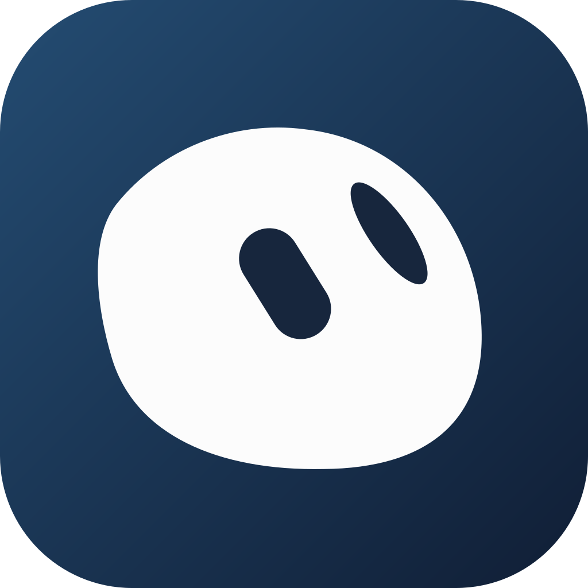
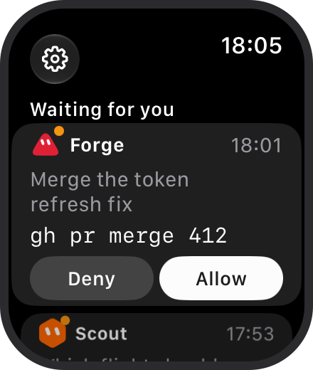
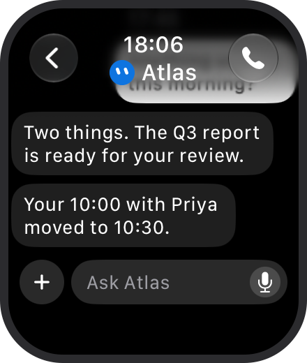
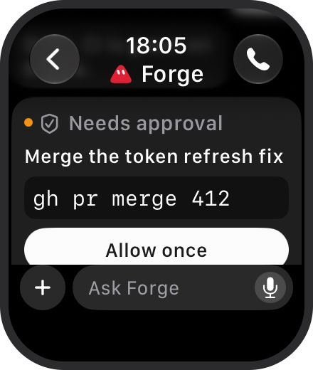
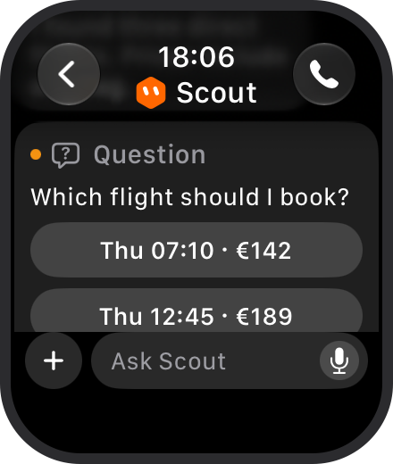
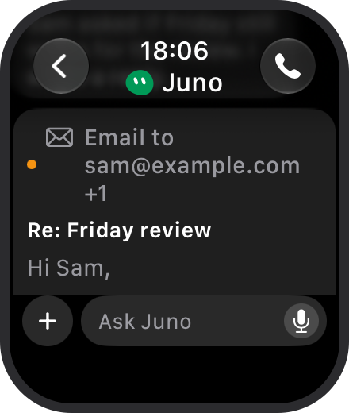

# grokwatch

An unofficial Apple Watch client for Grok Bot. It runs on the watch alone: there is no phone app and no relay server.

| Waiting for you | Chat | Approval | Question | Draft |
| :---: | :---: | :---: | :---: | :---: |
|  |  |  |  |  |

The screens show sample data from the app's [demo mode](watch/README.md#demo-mode), not a real account.

## Status and warning

- This project is unofficial. It is not affiliated with, endorsed by, or supported by the makers of Grok Bot, Cursor or xAI.
- It uses an internal API that has no public contract. Any app or server update can break it.
- It identifies itself to the server as the desktop client. This may be against the service's terms. You use your account at your own risk.
- There is no warranty. The licence says so too.

## What it does

- Sign in with your Cursor account: the watch shows a QR code, and you scan it with your phone.
- See your Bots as on the phone: pinned Bots, sections, previews, unread counts, and the Bots that wait for you.
- Chat with a Bot: history, live updates, photos, reactions, and dictation, scribble or typing.
- Answer cards: questions, approvals, email and Slack drafts, and forms.
- Hear a reply in the Bot's voice, or start a live voice call.
- See the unread count on the watch face with a complication.

The full list is in [`watch/README.md`](watch/README.md).

## Build and run

You build the app with Xcode and run it on a watch or in the simulator. The steps and requirements are in [`watch/README.md`](watch/README.md).

## How it works

The watch talks directly to the service's API. It uses the [Connect](https://connectrpc.com/docs/protocol) protocol with binary protobuf, and the message schemas are in [`proto/grokbot.proto`](proto/grokbot.proto). Voice calls use a realtime WebSocket. The notes in [`docs/grok-bot-protocol.md`](docs/grok-bot-protocol.md) describe the API.

## Where the material comes from

The schemas in `proto/` and the notes in `docs/` come from observation of the official desktop app. The avatar shapes and colours follow the look of the official apps. Product names and trademarks belong to their owners.

## Licence

GPL-2.0-or-later. See [`LICENSE`](LICENSE). You can use this program under version 2 of the licence, or (at your option) any later version.

Copyright (C) 2026 Judah Fuller

Dependencies: [swift-protobuf](https://github.com/apple/swift-protobuf) (Apache-2.0) and [swift-qrcode-generator](https://github.com/fwcd/swift-qrcode-generator) (MIT).

Created in [T3 Code](https://t3.codes).
